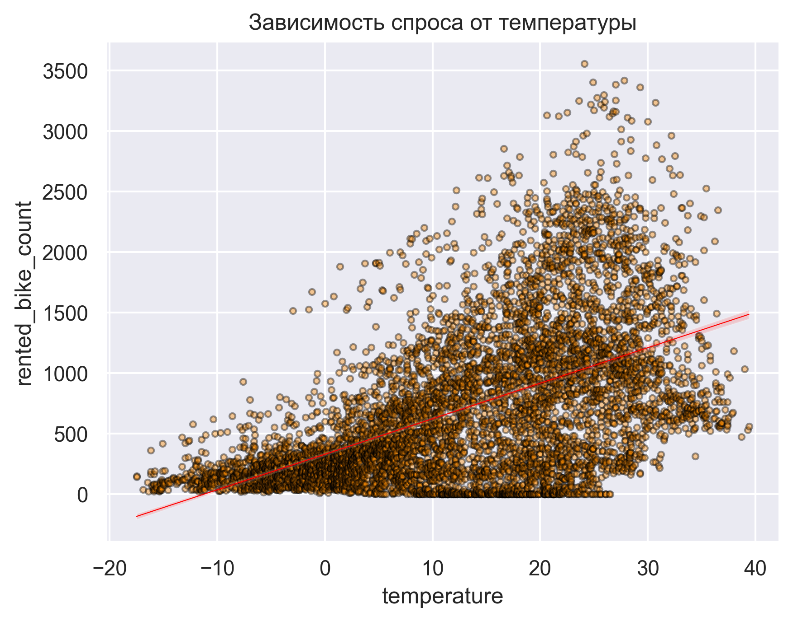
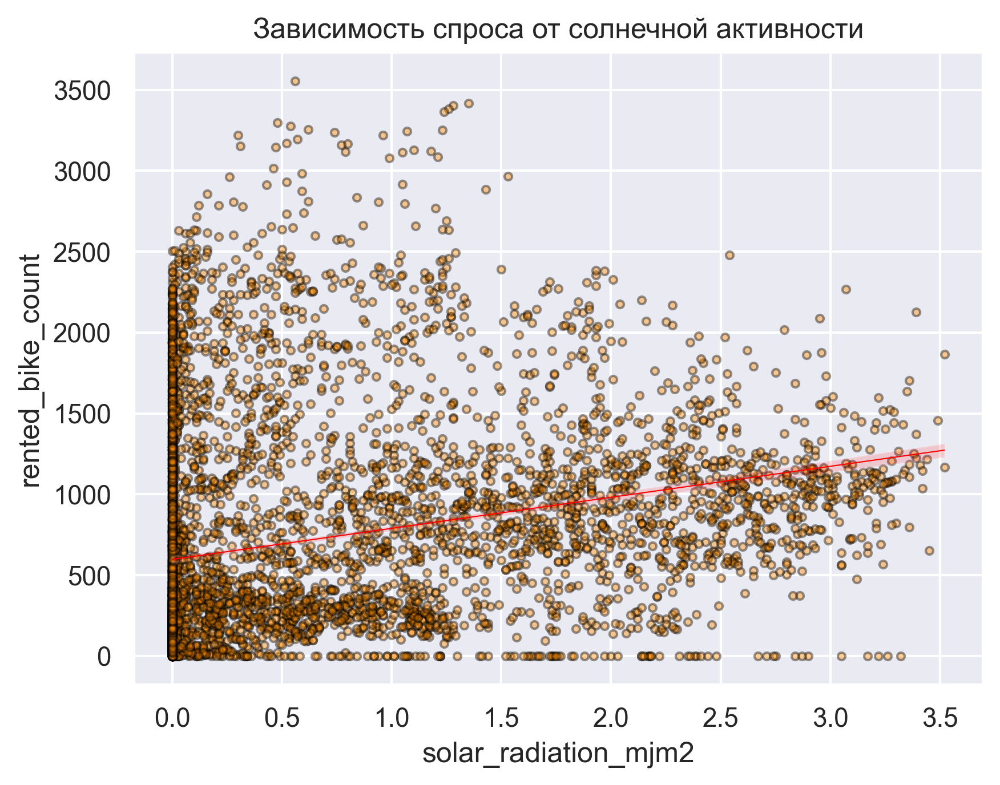
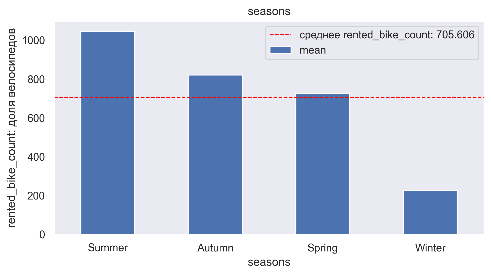
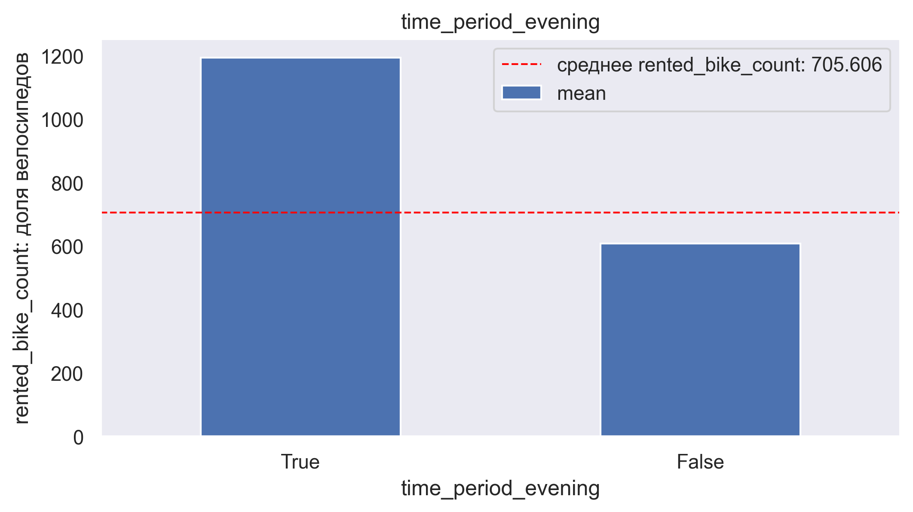
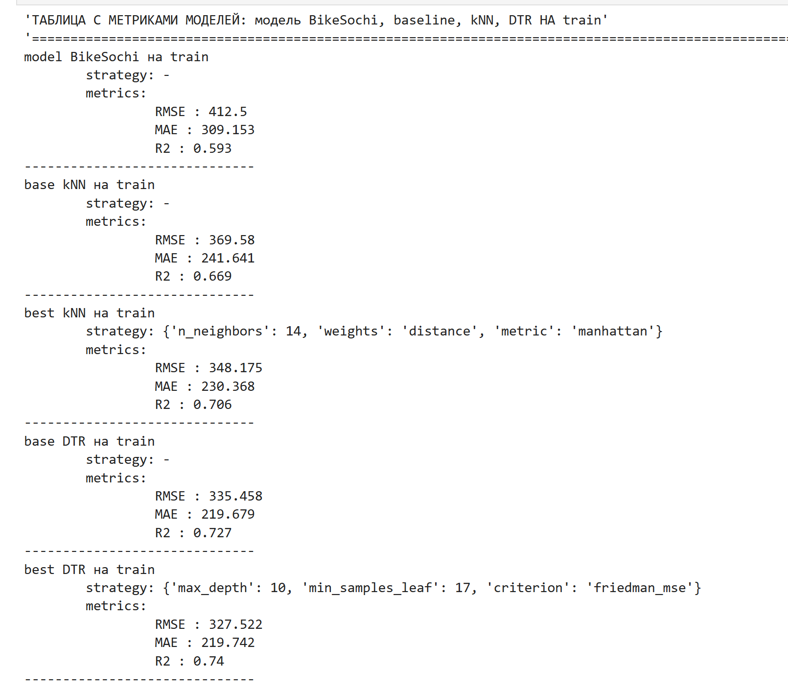
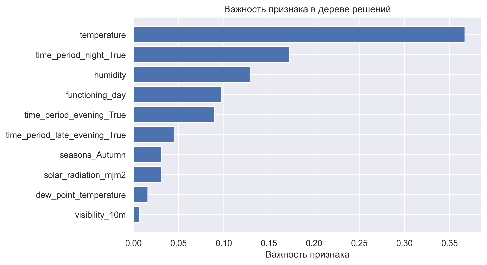

# 🚴‍♀️ Нелинейные модели против сочинской погоды

[О проекте](#-о-проекте) | [Технологический стек](#-технологический-стек) | [Инструкция по запуску](#-инструкция-по-запуску)

## 📊 О проекте

Компания **BikeSochi**, оператор городского велопроката в Сочи, обратилась за помощью в улучшении системы прогнозирования почасового спроса на велосипеды. До этого аналитики компании использовали простую линейную регрессию — одну из самых базовых моделей машинного обучения. Однако её прогнозы часто ошибались.

**Цель:** предложить новую, более гибкую модель прогнозирования почасового спроса на велосипеды для компании BikeSochi.

**Задачи:**
1. Изучить предоставленную компанией baseline-модель (линейную регрессию).
2. Обучить новые модели — K-ближайших соседей (KNN) и решающее дерево (Decision Tree).
3. В качестве целевой метрики использовать RMSE, дополнительные метрики — R², MAE.
4. Провести подбор гиперпараметров с помощью библиотеки Optuna.
5. Сравнить результаты всех подходов, выбрать наилучший и аргументировать свой выбор.

**Результаты:**
* Улучшенная модель прогноза почасового спроса на велосипеды в Сочи.
* Отчёт с метриками и сравнением подходов.
* Сохранённый пайплайн лучшей модели.

---

### Основные выводы и рекомендации

Построена улучшенная модель прогноза почасового спроса на велосипеды в Сочи, которая по данным погодных и календарных условий предсказывает, сколько велосипедов потребуется в каждый конкретный час.

* **Baseline (линейная регрессия):** модель стабильна, умеет обобщать, но предсказывает умеренно, объясняя около 59% вариации. В среднем, ошибка прогноза — 400 велосипедов в час ($RMSE = 412$).
* **EDA и данные:** проанализировано 7 категориальных признаков (`seasons`, `holiday`, `functioning_day`, `time_period_*`) и 9 непрерывных. Выбросы (например, в `wind_speed_ms`, `rainfallmm`) признаны допустимыми и не удалялись.
* **Ключевые зависимости:** спрос (`rented_bike_count`) зависит от температуры (`temperature`), солнечной радиации (`solar_radiation_mjm2`), времени суток и сезона.




Целевая переменная `rented_bike_count` распределена нелинейно: обнаружены колебания от времени года (`seasons`) и времени суток (`time_period_*`).




* **Корреляции:** самая сильная связь у `rented_bike_count` с `functioning_day`, а также `solar_radiation_mjm2` (0.75), `seasons` (0.7) и `temperature` (0.57).
* **Выбор модели:** определены две нелинейные модели (KNN и Decision Tree). По итогам оптимизации гиперпараметров через **Optuna** лучшей признана модель **решающего дерева (Decision Tree)**.



#### Характеристики лучшей модели (Decision Tree)
* **RMSE:** 324 (на 21% лучше baseline).
* **MAE:** 217 (модель лучше предсказывает в обычные часы, чем в часы пик).
* **R²:** 0.75 (модель объясняет 75% вариации).

**Важнейшие признаки (по убыванию значимости):**
1. Температура (`temperature`) — с её увеличением спрос растёт.
2. Ночное время аренды (`time_period_night`).
3. Влажность (`humidity`).
4. Вечернее время (`time_period_evening`).
5. Работа проката (`functioning_day`).
6. Поздний вечер (`time_period_late_evening`), осенний сезон (`seasons_Autumn`), солнечная радиация (`solar_radiation_mjm2`), точка росы (`dew_point_temperature`) и дождь (`rainfallmm`).



**Вывод:** на аренду велосипедов влияют разные факторы, в совокупности определяющие комфортную езду: сочетание комфортной температуры, влажности, солнечной активности и календарных условий (вечернее/ночное время, работа проката, осенний сезон).

## 💻 Технологический стек

* **Язык:** `python==3.10.22`
* **Анализ данных:** `numpy==2.2.5`, `pandas==2.3.3`, `scipy==1.15.3`
* **Машинное обучение:** `scikit-learn==1.6.1`, `joblib==1.6.0`
* **Визуализация:** `matplotlib==3.10.0`, `seaborn==0.13.2`, `plotly==7.0.0`
* **Валидация данных:** `pydantic==2.14.0`

## 🚀 Инструкция по запуску

### 1. Создание окружения
```bash
conda create -n my_project_env python=3.10
conda activate my_project_env
